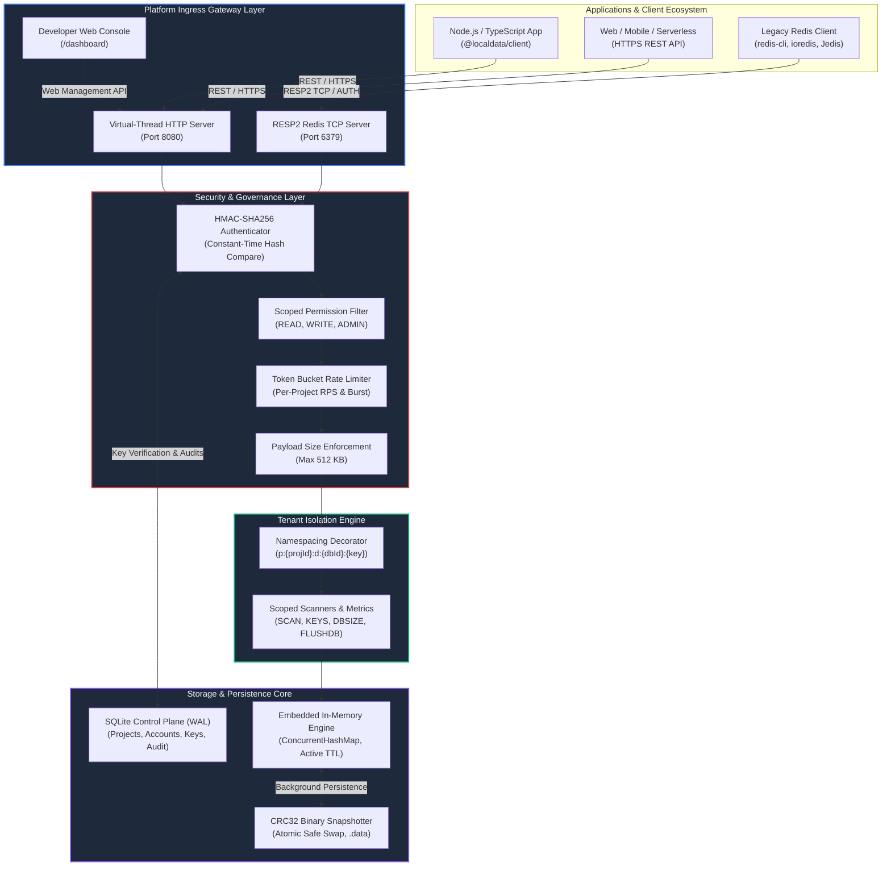
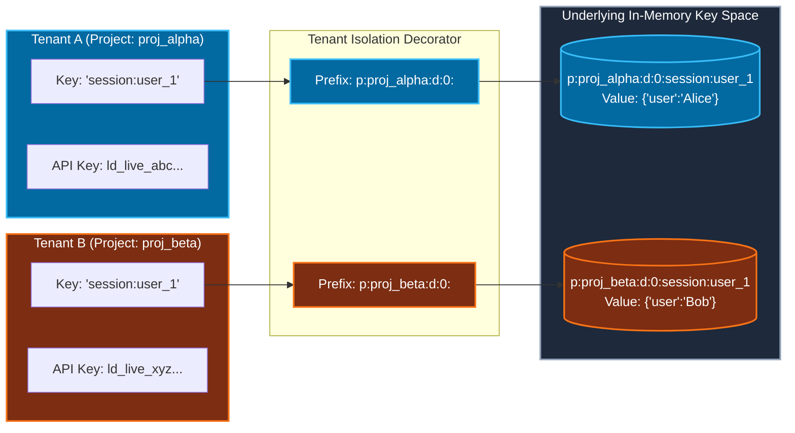
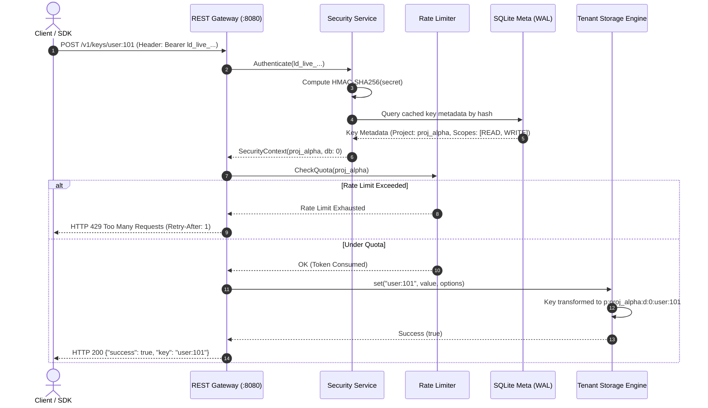
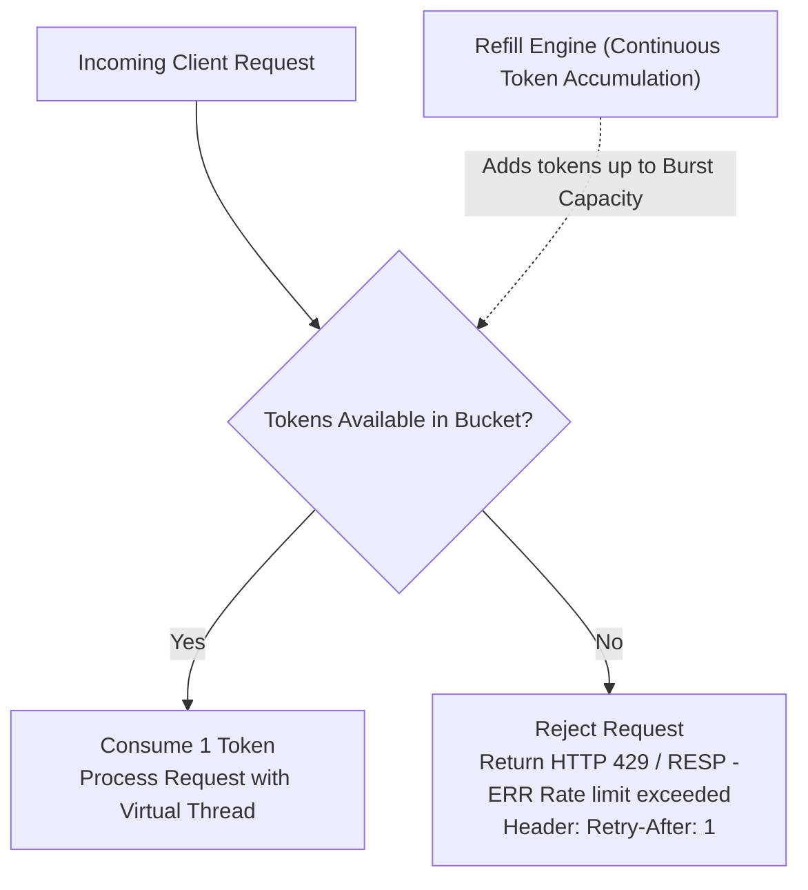

# LocalData: Production-Grade Redis-Compatible Managed Data Platform

<p align="center">
  
  
  
  
  
  
  
</p>

---

## 🌟 Overview

**LocalData** is a self-hostable, multi-tenant, Redis-compatible managed data platform. It bridges the gap between traditional Redis instances and modern cloud services like **Upstash** and **Redis Cloud**.

LocalData provides:
1. **REST API Gateway** on Port `8080` (powered by **Java 21 Virtual Threads**) for serverless and web client applications.
2. **RESP2 Redis TCP Server** on Port `6379` for existing Redis client libraries (`redis-cli`, `ioredis`, Jedis, Lettuce, redis-py).
3. **Physical Multi-Tenancy**: Complete tenant isolation at the keyspace layer (`p:{projectId}:d:{dbId}:{key}`). No client can ever inspect or mutate another client's data.
4. **Zero-Plaintext Security**: API keys (`ld_live_...`) are hashed using salted **HMAC-SHA256**. Secrets are displayed only once upon generation.
5. **Developer Dashboard**: An embedded modern single-page console at `http://localhost:8080/dashboard`.
6. **Official TypeScript / JavaScript SDK**: First-class developer experience with automatic deserialization, pipelining, and retries.

---

## 🏛️ System Architecture

The following diagram illustrates how clients connect through the dual-interface gateway down to the isolated storage engines and metadata repository:



---

## 🔒 Multi-Tenant Data Isolation Model

Every read and write operation is tagged with the authenticated project ID. Keys are physically transformed before reaching the underlying engine:



> **Security Guarantee:**
> - Both tenants use the identical key name (`session:user_1`).
> - Tenant A's `SCAN`, `GET`, `DEL`, or `FLUSHDB` can **never** observe or affect Tenant B's keys.
> - ID spoofing is mathematically impossible because the project ID is derived from the authenticated cryptographic key hash, not from user request parameters.

---

## ⚡ End-to-End Request & Authentication Flow



---

## 📊 Rate Limiting: Token Bucket Algorithm

Each project has its own dedicated in-memory token bucket configured with:
- **RPS (Refill Rate)**: Tokens added per second.
- **Burst Capacity**: Maximum burst size for high-traffic spikes.



---

## 🖥️ Developer Dashboard Preview

The embedded developer dashboard is served automatically at **`http://localhost:8080/dashboard`**:

- **Real-Time System Metrics**: Total requests, cache hit ratio, average response latency, and memory footprint.
- **Project Provisioning**: Create namespaces with custom RPS, burst allowances, and storage quotas.
- **API Key Management**: Generate scoped keys (`read`, `write`, `admin`), view one-time plaintext secrets, and trigger immediate revocation.
- **Live Data Explorer**: Scan, inspect, update, and delete keys interactively within any tenant namespace.
- **Security Audit Logs**: Track administrative events (key generation, revocations, and configuration changes) with IP logs.

---

## 📦 Official TypeScript / JavaScript SDK

Install the SDK from `sdk/typescript`:

```bash
cd sdk/typescript
npm install
npm run build
```

### Usage Example

```typescript
import { LocalDataClient } from "@localdata/client";

// Initialize client with environment variables or explicit config
const client = new LocalDataClient({
  apiKey: process.env.LOCALDATA_API_KEY, // e.g. "ld_live_..."
  baseUrl: process.env.LOCALDATA_URL || "http://localhost:8080"
});

async function main() {
  // 1. Store structured JSON or plain text
  await client.set("user:101", {
    name: "Alice",
    role: "Lead Engineer",
    verified: true
  });

  // 2. Retrieve automatically deserialized objects
  const user = await client.get<{ name: string; role: string }>("user:101");
  console.log(`Hello, ${user?.name}!`);

  // 3. Set keys with TTL expiration
  await client.set("session:token_xyz", "active", { ex: 3600 }); // 1 hour
  const remainingSeconds = await client.ttl("session:token_xyz");

  // 4. Atomic counters
  const pageViews = await client.incr("stats:views", 1);
  console.log(`Page views: ${pageViews}`);

  // 5. Batch multi-key operations (MSET / MGET)
  await client.mset({
    "cfg:theme": "dark",
    "cfg:notifications": "enabled"
  });
  const configs = await client.mget(["cfg:theme", "cfg:notifications"]);

  // 6. High-throughput Atomic Pipeline (single network round-trip)
  const results = await client.pipeline([
    { cmd: "SET", args: ["batch:1", "apple"] },
    { cmd: "SET", args: ["batch:2", "banana"] },
    { cmd: "GET", args: ["batch:1"] },
    { cmd: "GET", args: ["batch:2"] }
  ]);
  console.log("Pipeline output:", results); // ["OK", "OK", "apple", "banana"]

  // 7. Tenant Key Scanning
  const scan = await client.scan({ pattern: "cfg:*" });
  console.log("Found keys:", scan.keys);

  // 8. Delete keys
  await client.del("user:101");
}

main().catch(console.error);
```

---

## 🔌 Redis Wire Protocol (RESP2 Compatibility)

Connect using standard Redis clients over TCP port `6379`. Simply authenticate with your API key:

```bash
# Connect with standard redis-cli
redis-cli -h 127.0.0.1 -p 6379

# Authenticate session to your tenant namespace
127.0.0.1:6379> AUTH ld_live_4d970bec106dbaa790138234c44b99f8fd89073131a6da7c
+OK

# Execute commands inside your isolated database
127.0.0.1:6379> PING
+PONG
127.0.0.1:6379> SET mykey "Hello World"
+OK
127.0.0.1:6379> GET mykey
"Hello World"
127.0.0.1:6379> INCRBY visit_counter 10
(integer) 10
127.0.0.1:6379> TTL mykey
(integer) -1
127.0.0.1:6379> DBSIZE
(integer) 2
```

### Supported Command Matrix

| Category | Commands Supported |
|---|---|
| **Connection & Auth** | `AUTH`, `PING`, `ECHO`, `QUIT` |
| **String & KV** | `GET`, `SET` (with `EX`, `PX`, `NX`, `XX`), `SETNX`, `SETEX`, `MGET`, `MSET`, `APPEND`, `STRLEN` |
| **Counters** | `INCR`, `DECR`, `INCRBY` |
| **Key & Expiration** | `DEL`, `EXISTS`, `EXPIRE`, `PEXPIRE`, `TTL`, `PTTL`, `PERSIST` |
| **Server & Inspection** | `SCAN`, `KEYS`, `DBSIZE`, `FLUSHDB`, `INFO`, `SAVE`, `TIME` |

---

## 🌐 REST API Gateway Reference

All endpoints accept standard HTTP requests. Authenticate via `Authorization: Bearer <API_KEY>`.

### Data Endpoints (`/v1/`)

| Method | Endpoint | Query / Body | Description |
|---|---|---|---|
| `GET` | `/v1/keys/{key}` | - | Retrieve key value |
| `POST` | `/v1/keys/{key}` | `?ex={sec}&nx=true`, body: `{value}` | Store key value with optional TTL / NX / XX |
| `DELETE` | `/v1/keys/{key}` | - | Delete key |
| `POST` | `/v1/keys/{key}/incr` | `?delta={int}` | Atomic counter increment / decrement |
| `POST` | `/v1/keys/{key}/expire` | `?seconds={int}` | Set TTL on existing key |
| `GET` | `/v1/keys/{key}/ttl` | - | Get remaining TTL (-1 = infinite, -2 = missing) |
| `POST` | `/v1/mget` | `{"keys": ["k1", "k2"]}` | Multi-key get |
| `POST` | `/v1/mset` | `{"entries": {"k1":"v1", ...}}` | Multi-key set |
| `GET` | `/v1/scan` | `?pattern={glob}&count={n}` | Scan tenant keyspace |
| `POST` | `/v1/pipeline` | `[{"cmd":"SET","args":[...]}, ...]` | Execute batch atomically in 1 round-trip |
| `GET` | `/v1/dbsize` | - | Get total keys in project database |
| `POST` | `/v1/flushdb` | - | Clear only the authenticated project's data |

### Management & Control Plane Endpoints (`/api/`)

| Method | Endpoint | Description |
|---|---|---|
| `GET` | `/health` | Health & system readiness probe |
| `GET` | `/api/projects` | List all provisioned projects |
| `POST` | `/api/projects` | Create a new isolated project namespace |
| `GET` | `/api/projects/{id}` | Inspect project quotas and configuration |
| `DELETE` | `/api/projects/{id}` | Delete project and wipe all data |
| `GET` | `/api/projects/{id}/keys` | List API keys (safe masked prefix) |
| `POST` | `/api/projects/{id}/keys` | Generate new API key with scoped permissions |
| `DELETE` | `/api/projects/{id}/keys/{kId}` | Immediately revoke API key |
| `GET` | `/api/metrics` | Retrieve live latency, RPS, hit ratio, and errors |
| `GET` | `/api/audit-logs` | Retrieve tamper-evident administrative audit log |
| `POST` | `/api/backups/snapshot` | Trigger on-demand CRC32 data snapshot |

---

## 🚀 Quick Start

### 1. Build and Run Standalone (JAR)

```bash
# Prerequisites: JDK 21+ and Maven 3.9+
mvn clean package -DskipTests

# Run LocalData platform
java -jar target/mini-redis-1.0-SNAPSHOT-all.jar
```

On initial startup, the console prints:
```text
╔══════════════════════════════════════════════════════════════╗
║          LocalData Managed Redis Platform v1.0.0             ║
╚══════════════════════════════════════════════════════════════╝
  Data Directory   : C:\My Projects\Redis\data
  REST & Dashboard : http://0.0.0.0:8080
  Redis RESP TCP   : 0.0.0.0:6379
  Storage Engine   : Embedded In-Memory (CRC32 Snapshotting)

🔑 BOOTSTRAP API KEY (Save this now!):
   ld_live_a1b2c3d4e5f6...
👉 Open Dashboard: http://localhost:8080/dashboard
```

### 2. Docker & Docker Compose

```bash
docker compose up -d
```

Check health:
```bash
curl http://localhost:8080/health
```

---

## 🛠️ Testing & Verification

The platform includes a test suite covering unit tests, tenant isolation, cryptographic hashing, concurrency, and rate limiting:

```bash
# Run automated JUnit 5 test suite (40 tests)
mvn test

# Run full live end-to-end integration suite (18 scenarios)
powershell -ExecutionPolicy Bypass -File .\verify_all.ps1

# Run TypeScript SDK live suite
cd sdk/typescript
npm test
```

---

## 📖 Additional Documentation

- [INSTALLATION.md](file:///C:/My%20Projects/Redis/INSTALLATION.md) — Comprehensive installation, Linux systemd service, Windows service, and production deployment guide.
- [docs/ARCHITECTURE.md](file:///C:/My%20Projects/Redis/docs/ARCHITECTURE.md) — Detailed internal architectural specifications.
- [docs/REST_API.md](file:///C:/My%20Projects/Redis/docs/REST_API.md) — Complete REST API specification with cURL examples.
- [docs/SECURITY.md](file:///C:/My%20Projects/Redis/docs/SECURITY.md) — Threat model, RBAC matrix, and cryptographic guarantees.
- [docs/RUNBOOK.md](file:///C:/My%20Projects/Redis/docs/RUNBOOK.md) — Operational runbooks, disaster recovery, and backup restoration.

---

## 📄 License

LocalData is distributed under the [Apache 2.0 License](file:///C:/My%20Projects/Redis/LICENSE).
